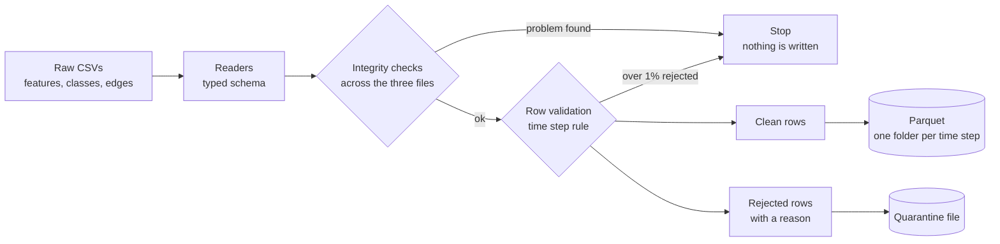

# GraphGuard

A data engineering pipeline over the Elliptic Bitcoin transaction graph: about 200,000 transactions across 49 time steps, each labelled illicit, licit or unknown.

The raw files are messy in the ways real data is: a features file with no header row, a label column that mixes numbers and the word `unknown`, and edges that must point at transactions that actually exist. GraphGuard loads them with explicit data quality rules, quarantines bad rows instead of hiding them, and writes typed Parquet partitioned by time step. Spark, Airflow, cloud infrastructure, streaming and a drift check are planned on top (see [Status](#status)).

## What it does today

- Reads the three Elliptic CSVs with a typed schema (the features file has no header, so the column names are supplied by the loader).
- Checks the files against each other: no orphan edges, no edges crossing time steps, class ids that match feature ids, no duplicate transactions.
- Validates every row and quarantines rejects with a reason. The run stops if more than 1% of rows are rejected.
- Writes Parquet, one folder per time step, replaced safely so a rerun never doubles rows and a crash never leaves a half-written step.

Run on the full dataset it takes about 4 seconds on a laptop, and the 690 MB features file becomes about 100 MB of Parquet.

## Architecture



Every check that can stop the run happens before the first write, so a failed run leaves the previous good output untouched. More detail is in [docs/architecture.md](docs/architecture.md).

## Quick start (Windows, PowerShell)

```powershell
git clone https://github.com/peiris830/GraphGuard.git
cd GraphGuard
py -3.12 -m venv .venv
.venv\Scripts\Activate.ps1
pip install -e ".[dev]"
pytest
```

Get the data from Kaggle ("Elliptic Data Set" by Elliptic) and place the three CSVs in `data/raw/elliptic_bitcoin_dataset/` (gitignored, never committed):
`elliptic_txs_features.csv`, `elliptic_txs_classes.csv`, `elliptic_txs_edgelist.csv`.

Then run the pipeline:

```powershell
python -m graphguard.pipeline
```

It prints what it read, wrote and rejected, and exits with code 0 on success or 1 with the reason on failure. Options: `--raw`, `--out` and `--max-reject-rate`.

Query the output with DuckDB (reads the Parquet in place, no server):

```powershell
python -m graphguard.queries              # transactions, edges and labels per time step
python -m graphguard.queries --step 7     # busiest transactions of one time step
```

Output goes to `data/processed/` (gitignored):

```
data/processed/
├── features/time_step=1/part-0.parquet  ...  time_step=49/
├── classes/time_step=1/...
├── edges/time_step=1/...                (partitioned by the source transaction's step)
└── quarantine/features.parquet          (rejected rows and why; empty means none)
```

## Status

| Phase | What | State |
|---|---|---|
| 0 | Repo skeleton, tests, first validation rule | Done (`v0.1.0-foundation`) |
| 1 | Local batch pipeline: load, validate, write Parquet, query with DuckDB | In progress: loading, checks, quarantine, Parquet output and DuckDB queries done; failure drills left |
| 2 | PySpark: joins, in/out degree per time step | Planned |
| 3 | AWS with Terraform: S3, IAM, Athena | Planned |
| 4 | Airflow: one idempotent run per time step | Planned |
| 5 | Streaming: replay time steps through Kafka | Planned |
| 6 | FastAPI, Streamlit page, drift check after time step 43 | Planned |
| 7 | CI, benchmarks, diagram, polish | Planned |

## Key design decisions

Every real decision is recorded in [DECISIONS.md](DECISIONS.md) with the alternatives and the trade-off. A few that shape the code:

- **Strict at the door.** `is_valid_time_step` rejects `True` (it means yes, not week 1), strings, NaN and fractions, because a validator that accepts surprises hides upstream bugs.
- **Quarantine, don't drop.** One bad row should not block 200,000 good ones, and it should never vanish silently.
- **`unknown` becomes a real null,** with the original text kept, so labels are a nullable integer and not a mixed-type column.
- **Check everything, then write.** A failed run leaves the previous output intact.
- **Idempotent writes.** Rerunning a time step replaces it; it never appends.

## Documentation

- [docs/data.md](docs/data.md): the three files, their quirks, and what was verified about them.
- [docs/architecture.md](docs/architecture.md): data flow, modules, failure behaviour and where later phases plug in.
- [DECISIONS.md](DECISIONS.md): why things are built the way they are.

## Troubleshooting: `CERTIFICATE_VERIFY_FAILED` on pip install

Antivirus HTTPS scanning (e.g. Avast Web Shield) re-signs traffic with its own root certificate, which Python's bundled CA list does not trust. Make pip use the Windows certificate store instead:

```powershell
$env:PIP_USE_FEATURE="truststore"
pip install -e ".[dev]"
```

## Licence

MIT, see [LICENSE](LICENSE).
