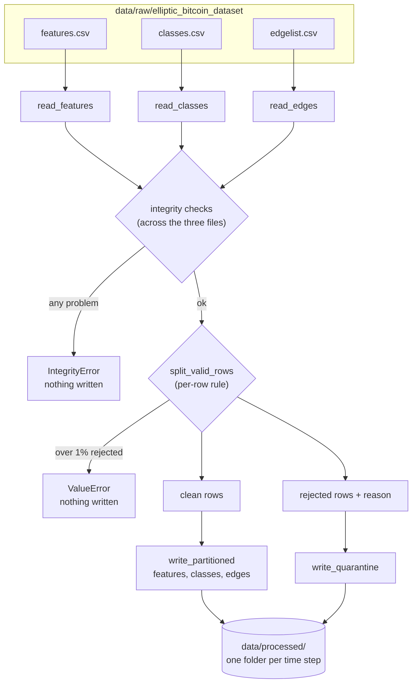

# Architecture

GraphGuard is a batch pipeline. It takes three raw CSV files and produces typed, partitioned Parquet that later phases (Spark, Airflow, the cloud, streaming, the drift check) build on. This document describes what exists today and where the next phases plug in.

## Data flow



The order is the point: everything that can stop the run happens before the first write. A failed run therefore leaves the previous good output exactly as it was.

## Modules

All code lives in `src/graphguard/`.

| Module | Responsibility | Deliberately does not |
|---|---|---|
| `loader.py` | read one CSV into a typed DataFrame with explicit column names; fail loudly on a wrong column count or unexpected class value | check one file against another |
| `validation.py` | single-value rules (`is_valid_time_step`) | touch tables or files |
| `integrity.py` | table-level checks across files; each returns the offending rows, empty meaning pass | decide what to do about a problem |
| `quarantine.py` | split rows into clean and rejected, stop above the reject threshold | write anything |
| `writer.py` | write partitioned Parquet and the quarantine file safely | decide which rows are good |
| `pipeline.py` | run the steps in order, summarise, and provide the command line | contain rules of its own |

Keeping decisions (checks, thresholds) apart from actions (reading, writing) is what keeps each module testable with a handful of hand-made rows, without the 690 MB file.

## Failure behaviour

| Situation | What happens |
|---|---|
| A file has the wrong number of columns | the reader raises, with the expected and actual counts |
| A class value other than `1`, `2` or `unknown` | the reader raises, listing the unexpected values |
| An edge points at a transaction that is not in the features file | `IntegrityError`; nothing written |
| An edge connects two different time steps | `IntegrityError`; nothing written |
| A transaction appears twice | `IntegrityError`; nothing written |
| Class ids and feature ids do not match | `IntegrityError`; nothing written |
| A few rows have an invalid time step (up to 1%) | rows go to the quarantine file with a reason; the run continues |
| More than 1% of rows are invalid | `ValueError`; nothing written, because that usually means something upstream broke |
| The process dies while writing a step | the step is written to a temporary folder and renamed into place, so readers see the old or the new version, never half of one |
| The pipeline is run twice | each step is replaced, not appended, so the result is identical and rows are never doubled |

All integrity problems are reported together, with counts and examples, so one rerun can fix several.

## Output layout

```
data/processed/
├── features/time_step=<1..49>/part-0.parquet
├── classes/time_step=<1..49>/part-0.parquet
├── edges/time_step=<1..49>/part-0.parquet     partitioned by the source transaction's step
└── quarantine/features.parquet                 written even when empty
```

The partition value lives in the folder name, not in the file. This is the Hive convention that DuckDB and Spark both read natively. The quarantine file is written even when it has no rows, so "checked, nothing rejected" can be told apart from "never checked".

Edges take their source transaction's time step. That is safe because the integrity check guarantees no edge crosses a step.

## Design principles

- **Strict at the door.** Reject surprises early, where they are cheap to fix, instead of letting them reach models or dashboards.
- **Return the bad rows, not a yes or no.** Callers can then quarantine, count and report exactly what failed.
- **Check everything, then write.** A run either completes or changes nothing.
- **Idempotent by construction.** Rerunning is always safe, which is the property Airflow depends on.
- **Each problem is reported once.** A check skips what another check already covers, so reject counts are honest.

## Where later phases plug in

| Phase | Builds on |
|---|---|
| 1 (finish) | DuckDB queries over `data/processed/`, to show the output is usable |
| 2: Spark | reads the Parquet; no edge crosses a time step, so degree counts can be computed one step at a time |
| 3: AWS | the same layout, written to S3 and exposed through Athena; infrastructure defined in Terraform |
| 4: Airflow | calls `run_pipeline`; because writes replace a whole step, one run per time step is safe to retry |
| 5: Streaming | replays time steps as events; uses the same validation rules |
| 6: Serving and drift | reads the Parquet; the drift check compares feature distributions before and after step 43 |

## Known limits

- `run_pipeline` processes every time step in one call. Airflow's one-run-per-step design will need a step parameter.
- The checks hold all three tables in memory. That is fine at this size (about 4 seconds for the full run) and is the reason heavy joins move to Spark in Phase 2.
- Rows of the classes and edges tables that belong to a quarantined transaction are dropped and counted, but not stored. This never happens in the real data.
- The directory swap is not fully atomic: a crash between its two renames leaves the previous version in a hidden `.old-` folder, misplaced but not lost. See [DECISIONS.md](../DECISIONS.md).
